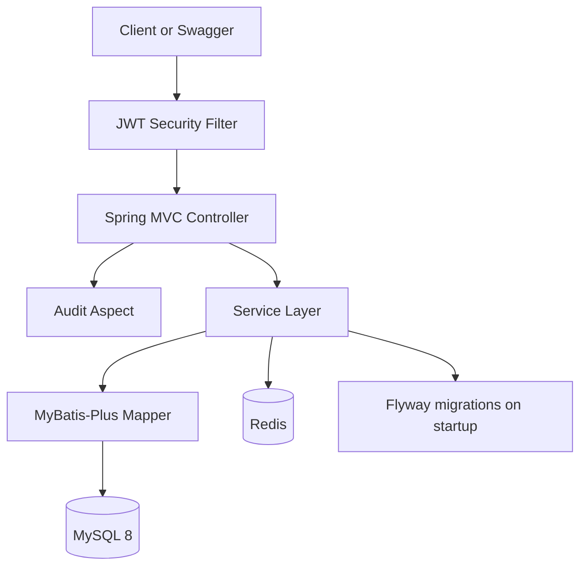
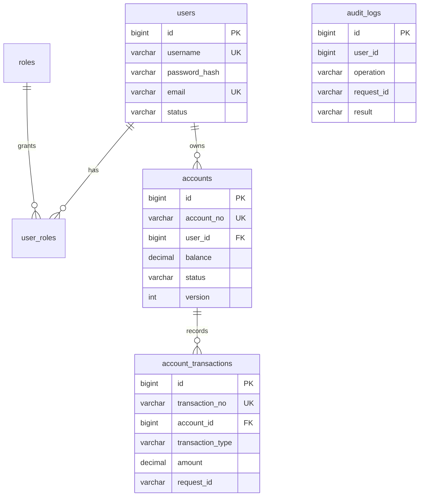

# CoreLedger Architecture

## Business Requirement

CoreLedger is a personal Java backend engineering project for enterprise-style account and transaction ledger management. It supports registration, login, JWT authentication, RBAC, account creation, balance changes, transaction history, Redis idempotency, account caching, audit logging and consistent API errors.

It is not presented as a bank production system.

## System Architecture

## Database Design

Key indexes:

- `users.username` prevents duplicate registration.
- `accounts.account_no` and `account_transactions.transaction_no` guarantee externally visible identifiers are unique.
- `account_transactions(account_id, request_id)` is the database-level backstop for duplicate transaction submission.
- `user_id`, `account_id`, and `created_at` indexes support ownership checks and paginated history queries.

## API

- `POST /api/v1/auth/register`
- `POST /api/v1/auth/login`
- `GET /api/v1/users/me`
- `POST /api/v1/accounts`
- `GET /api/v1/accounts`
- `GET /api/v1/accounts/{id}`
- `POST /api/v1/accounts/{id}/deposit`
- `POST /api/v1/accounts/{id}/withdraw`
- `GET /api/v1/accounts/{id}/transactions`
- `GET /api/v1/admin/users`
- `GET /api/v1/admin/accounts`
- `GET /api/v1/admin/audit-logs`

## Security Scheme

Spring Security runs stateless JWT authentication. Public endpoints are limited to auth and Swagger/OpenAPI. `/api/v1/admin/**` requires `ROLE_ADMIN`; normal users receive a unified `FORBIDDEN` response.

JWT contains `userId`, `username` and `roles`. The signing secret is configured through `JWT_SECRET`, not hardcoded in Java.

## Redis Scheme

Redis is used for two real scenarios:

- Idempotency: `idempotency:transaction:{accountId}:{requestId}` is written with SETNX before balance mutation.
- Cache Aside: `cache:account:{accountId}` stores account snapshots, with short-lived null cache values for cache penetration protection.

## Transaction Scheme

Deposit and withdraw are wrapped in `@Transactional`. The service reads account state, validates ownership/status/amount, updates balance with optimistic locking, then writes transaction history. If any step fails, MySQL rolls back the update and insert.

## Idempotency Scheme

The transaction request must include `requestId`. Redis SETNX rejects repeated submissions. If the business operation fails, the Redis key is deleted in `finally`, so a transient failure does not permanently occupy the request id. On success, the key remains for a TTL and the database unique index provides a second guard.

## Development Tasks

- Build Maven project and schema migrations.
- Implement auth, JWT and RBAC.
- Implement accounts, transactions, idempotency and cache.
- Add audit logging and global exception handling.
- Add tests and Docker local runtime.
