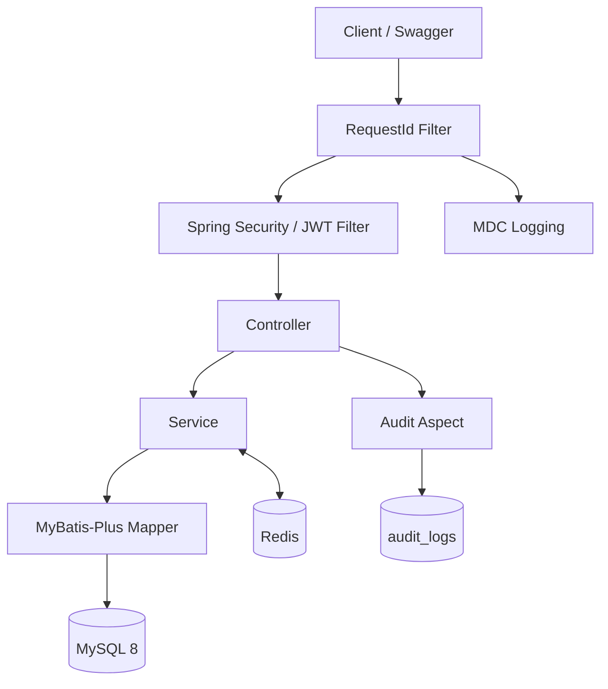
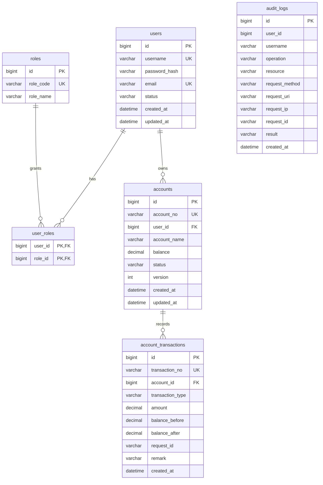
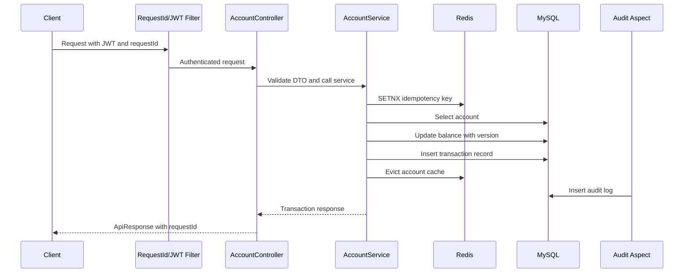

# CoreLedger

企业内部账户与资金流水管理系统  
Enterprise Account & Transaction Ledger Service

基于真实小型商贸业务数字化需求设计并开发的 Java 企业后端系统，重点解决账户管理、资金流水、权限控制、事务一致性、重复提交、并发更新及操作审计等问题。

A Java backend system designed around the real internal digital-management requirements of a small trading business, focusing on account management, transaction records, access control, transaction consistency, idempotency, concurrent updates and auditability.

## 项目简介 | Overview

CoreLedger 是一个基于家族经营商贸业务内部数字化需求设计并开发的企业账户与资金流水管理后端系统。

系统围绕“用户 - 权限 - 账户 - 交易 - 审计”构建核心业务流程，为企业内部资金收支记录及业务账户管理提供统一后端服务。项目重点关注 Java 企业后端开发中的事务一致性、并发更新、接口幂等、缓存一致性、身份认证、权限控制、操作审计及可测试性。

CoreLedger is an enterprise account and transaction ledger backend designed for the internal digital-management needs of a family-operated trading business.

The system is built around the core flow of users, roles, accounts, transactions and audit logs. It provides a unified backend for internal fund-entry, fund-withdrawal and ledger-account management, with emphasis on transaction consistency, concurrent updates, idempotency, cache consistency, authentication, RBAC, auditability and testability.

## 项目背景 | Business Background

传统小型商贸企业的内部资金管理通常会涉及销售回款、采购支出、运营费用及其他资金变动。随着多个业务人员共同操作系统，后端需要解决权限边界、重复提交、余额一致性、交易可追踪和操作审计等问题。

CoreLedger 围绕这些需求构建了 `User`、`Role`、`Account`、`AccountTransaction` 和 `AuditLog` 等核心模型。当前项目聚焦账户与资金流水闭环，不包含商品、订单、供应商或完整 ERP 模块。

Internal fund management in a small trading business may involve sales collections, purchasing expenses, operating costs and other business fund changes. When multiple staff members operate the system, the backend must handle access boundaries, duplicate submissions, balance consistency, traceable transactions and audit records.

CoreLedger addresses these requirements through core models such as `User`, `Role`, `Account`, `AccountTransaction` and `AuditLog`. The current scope focuses on accounts and transaction ledgers, not product, order, supplier or full ERP management.

## 核心功能 | Features

- 用户注册/登录：支持注册、登录和当前用户查询，解决内部系统身份识别问题。
- BCrypt 密码加密：数据库只保存密码哈希，不保存明文密码。
- JWT：登录后签发 access token，用于访问受保护接口。
- RBAC：内置 `ROLE_USER` 和 `ROLE_ADMIN`，管理员接口独立授权。
- 账户创建与查询：支持创建企业内部业务资金账户、分页查询和详情查询。
- 资金入账：记录 inbound transaction，并更新账户余额。
- 资金出账：记录 outbound transaction，并校验账户状态与余额。
- 交易流水查询：支持分页、交易类型和时间范围筛选。
- MySQL Transaction：余额修改和交易流水写入在同一事务内完成。
- Optimistic Lock：使用 `accounts.version` 与 MyBatis-Plus `@Version` 防止静默覆盖余额。
- Redis Idempotency：使用 `requestId` + Redis SETNX 防止重复提交。
- Redis Cache：账户详情使用 Cache Aside Pattern，并处理缓存穿透。
- Audit Logging：关键操作通过 `@Audit` 和 Spring AOP 写入审计日志。
- RequestId：统一请求追踪，写入响应、日志 MDC 和审计记录。
- Global Exception Handling：统一错误码和统一响应结构。
- Validation：使用 Jakarta Validation 处理参数校验。
- Flyway：应用启动时自动初始化数据库表和基础角色。
- Swagger/OpenAPI：提供接口文档和本地调试入口。
- JUnit/Mockito：覆盖认证与账户交易核心服务逻辑。
- Docker Compose：支持 MySQL、Redis、应用服务的本地容器化运行。

English summary:

- Registration and login identify internal system users.
- BCrypt protects stored passwords.
- JWT secures protected APIs.
- RBAC separates user and administrator permissions.
- Account APIs manage internal business ledger accounts.
- Deposit and withdraw APIs record inbound and outbound fund movements.
- Transaction history APIs support paginated business traceability.
- MySQL transactions keep balances and transaction records consistent.
- Optimistic locking prevents silent lost updates.
- Redis SETNX provides request-level idempotency.
- Redis account caching improves read paths while keeping cache consistency manageable.
- AOP audit logging and RequestId tracing improve operational accountability.

## 技术栈 | Tech Stack

| Layer | Technology |
| --- | --- |
| Language | Java 17 |
| Framework | Spring Boot 3, Spring MVC |
| Security | Spring Security 6, JWT, BCrypt, RBAC |
| Persistence | MyBatis-Plus, MySQL 8, Flyway |
| Cache / Idempotency | Redis |
| Validation | Jakarta Validation |
| API Docs | Springdoc OpenAPI / Swagger UI |
| Testing | JUnit 5, Mockito |
| Build / Runtime | Maven, Docker, Docker Compose |

## 系统架构 | Architecture



更多设计说明见 [ARCHITECTURE.md](./ARCHITECTURE.md)。

See [ARCHITECTURE.md](./ARCHITECTURE.md) for additional architecture notes.

## 数据库设计 | Database Design

真实 Flyway schema 包含六张核心业务表：

- `users`
- `roles`
- `user_roles`
- `accounts`
- `account_transactions`
- `audit_logs`

The actual Flyway schema contains six core business tables:



关键约束包括 `username` 唯一、`account_no` 唯一、`transaction_no` 唯一，以及 `account_id + request_id` 唯一约束，用于为幂等控制提供数据库兜底。

Important constraints include unique `username`, unique `account_no`, unique `transaction_no`, and unique `account_id + request_id`, which acts as a database-level backstop for transaction idempotency.

## 核心业务流程 | Core Business Flow



## 事务与数据一致性 | Transaction & Data Consistency

`deposit` 和 `withdraw` 使用 Spring `@Transactional`。一次余额变更必须保证账户余额修改和 `account_transactions` 流水写入同时成功或同时失败。

如果余额不足，服务返回 `INSUFFICIENT_BALANCE`，账户余额保持不变，并且不会生成成功交易流水。该行为已经在本地真实运行环境中验证通过。

`deposit` and `withdraw` are wrapped with Spring `@Transactional`. A balance change must update the account and insert the transaction record as one atomic operation.

When the account balance is insufficient, the service returns `INSUFFICIENT_BALANCE`; the account balance remains unchanged and no successful transaction record is inserted. This behavior has been verified locally.

## 并发控制 | Concurrency Control

同一账户被多个请求同时修改时，可能出现 Lost Update：两个请求读取同一余额，各自计算新余额，后写入的请求覆盖先写入的结果。

CoreLedger 使用 `accounts.version` 字段和 MyBatis-Plus `@Version` 实现乐观锁。余额更新失败时返回 `OPTIMISTIC_LOCK_CONFLICT`，不会无限重试。

本地并发请求验证确认：冲突的余额更新会被检测并拒绝，而不是静默覆盖账户余额。该验证不是性能基准，也不代表生产环境高并发能力。

When multiple requests update the same account concurrently, a Lost Update can happen if two requests read the same balance and later overwrite each other.

CoreLedger uses the `accounts.version` field and MyBatis-Plus `@Version` for optimistic locking. If the balance update fails because another request has already changed the row, the service returns `OPTIMISTIC_LOCK_CONFLICT` without unlimited retries.

Local concurrent request verification confirmed that conflicting balance updates are detected and rejected instead of silently overwriting account balances. This is a correctness check, not a production benchmark.

## 幂等设计 | Idempotency

资金入账和资金出账请求必须携带 `requestId`。服务使用 Redis SETNX 写入：

```text
idempotency:transaction:{accountId}:{requestId}
```

首次请求写入成功后执行业务逻辑。业务成功后 key 更新为 `COMPLETED` 并保留 TTL；重复请求返回 `DUPLICATE_REQUEST`。如果业务异常，服务会释放幂等 key，避免失败请求永久占用 `requestId`。

重复提交同一个 `requestId` 已在本地运行环境中验证：不会重复修改余额，也不会生成重复交易流水。

Deposit and withdraw requests must include `requestId`. The service uses Redis SETNX with:

```text
idempotency:transaction:{accountId}:{requestId}
```

The first request proceeds. After success, the key is marked as `COMPLETED` with a TTL. Repeated requests return `DUPLICATE_REQUEST`. If the business operation fails, the key is removed to avoid permanently occupying the request id.

Duplicate `requestId` behavior has been verified locally: it does not update the balance twice and does not create duplicate transaction records.

## Redis 缓存策略 | Redis Cache Strategy

账户详情查询采用 Cache Aside Pattern：

1. 先查询 Redis。
2. 未命中时查询 MySQL。
3. 查询结果写入 Redis。
4. 余额变更后删除账户缓存。

不存在的账户会写入短 TTL 的 null marker，用于降低缓存穿透风险。该策略不引入 Bloom Filter，保持当前项目规模下的实现清晰度。

Account detail queries use the Cache Aside Pattern:

1. Read Redis first.
2. Query MySQL on cache miss.
3. Write the result back to Redis.
4. Evict account cache after balance changes.

Missing accounts are cached with a short-lived null marker to reduce cache penetration. A Bloom Filter is intentionally not introduced for the current project scope.

## 认证与权限 | Security & RBAC

系统使用 Spring Security 6、BCrypt、JWT 和 RBAC。

- 注册用户默认绑定 `ROLE_USER`。
- `/api/v1/admin/**` 需要 `ROLE_ADMIN`。
- 普通用户访问管理员接口返回统一 `FORBIDDEN` 响应。
- 管理员角色加入后重新登录，新的 JWT 可访问管理员接口。
- JWT Secret 通过环境变量配置，不在 Java 代码中硬编码。

本地 RBAC 已验证：普通用户访问管理员接口返回 403，管理员 token 可以访问 `/api/v1/admin/users`、`/api/v1/admin/accounts`、`/api/v1/admin/audit-logs`。

The system uses Spring Security 6, BCrypt, JWT and RBAC.

- Registered users receive `ROLE_USER` by default.
- `/api/v1/admin/**` requires `ROLE_ADMIN`.
- Normal users receive a unified `FORBIDDEN` response for admin APIs.
- After granting admin role and logging in again, the new JWT can access admin APIs.
- JWT Secret is configured through environment variables and is not hardcoded in Java.

RBAC has been verified locally: normal users receive 403 for admin APIs, while admin tokens can access the admin endpoints.

## 操作审计与请求追踪 | Audit Logging & Request Tracing

关键接口使用 `@Audit` 和 Spring AOP 写入 `audit_logs`，记录：

- `userId`
- `username`
- `operation`
- `method`
- `URI`
- `IP`
- `requestId`
- `result`
- `createdAt`

`RequestIdFilter` 会读取请求头 `X-Request-Id`。如果请求未携带该 header，系统自动生成 UUID。`requestId` 会写入 HTTP response、日志 MDC 和审计日志。

日志中不打印用户密码、JWT Secret 或完整 Bearer Token。

Key APIs use `@Audit` and Spring AOP to write audit records into `audit_logs`, including user, operation, HTTP metadata, request id, result and time.

`RequestIdFilter` reads `X-Request-Id` from request headers. If it is absent, the system generates a UUID. The request id is included in the HTTP response, MDC logs and audit records.

Passwords, JWT secrets and full Bearer tokens are not logged.

## API 示例 | API Examples

以下示例使用虚构测试用户。运行前请确保应用已启动。

The examples below use fictional test data. Make sure the application is running first.

### Register

```bash
curl -X POST http://localhost:8080/api/v1/auth/register \
  -H 'Content-Type: application/json' \
  -d '{"username":"alice","password":"Password123!","email":"alice@example.com"}'
```

### Login

```bash
TOKEN=$(curl -s -X POST http://localhost:8080/api/v1/auth/login \
  -H 'Content-Type: application/json' \
  -d '{"username":"alice","password":"Password123!"}' | jq -r '.data.accessToken')
```

### Create Account

```bash
curl -X POST http://localhost:8080/api/v1/accounts \
  -H "Authorization: Bearer $TOKEN" \
  -H 'Content-Type: application/json' \
  -d '{"accountName":"Main Account"}'
```

### Deposit

```bash
curl -X POST http://localhost:8080/api/v1/accounts/1/deposit \
  -H "Authorization: Bearer $TOKEN" \
  -H 'Content-Type: application/json' \
  -d '{"amount":1000.00,"requestId":"deposit-demo-001","remark":"initial fund entry"}'
```

### Withdraw

```bash
curl -X POST http://localhost:8080/api/v1/accounts/1/withdraw \
  -H "Authorization: Bearer $TOKEN" \
  -H 'Content-Type: application/json' \
  -d '{"amount":200.00,"requestId":"withdraw-demo-001","remark":"operating expense"}'
```

### Transaction History

```bash
curl -H "Authorization: Bearer $TOKEN" \
  'http://localhost:8080/api/v1/accounts/1/transactions?page=1&size=10'
```

Swagger UI:

```text
http://localhost:8080/swagger-ui.html
```

OpenAPI JSON:

```text
http://localhost:8080/v3/api-docs
```

## 本地运行 | Local Development

Requirements:

- Java 17
- Maven 3.9+
- Docker
- Docker Compose

复制环境变量模板：

Copy environment template:

```bash
cp .env.example .env
```

启动 MySQL 和 Redis：

Start MySQL and Redis:

```bash
docker compose up -d mysql redis
```

启动 Spring Boot：

Run Spring Boot:

```bash
export JWT_SECRET=change_me_to_a_long_random_secret_at_least_32_chars
mvn spring-boot:run
```

Flyway 会在应用启动时自动执行。当前本地 MySQL 8 开发容器使用的 JDBC URL 已包含 `allowPublicKeyRetrieval=true`。

Flyway automatically runs on startup. The local MySQL 8 development-container JDBC URL includes `allowPublicKeyRetrieval=true`.

## Docker 部署 | Docker Deployment

这里的 Docker deployment 指本地容器化部署，不代表生产环境部署。

Docker deployment here means local containerized deployment, not production deployment.

启动完整本地 Docker Compose 栈：

Start the full local Docker Compose stack:

```bash
docker compose up -d --build
```

该命令会启动：

This starts:

- `coreledger-app`
- `coreledger-mysql`
- `coreledger-redis`

完整本地 Docker Compose 栈已经真实验证通过，容器化应用可连接容器内 MySQL 与 Redis，并完成登录、账户查询和资金入账接口验证。

The full local Docker Compose stack has been verified successfully. The containerized application can connect to MySQL and Redis containers and complete login, account query and deposit API checks.

停止本地容器：

Stop local containers:

```bash
docker compose down
```

## 测试与验证 | Testing & Verification

运行单元测试：

Run unit tests:

```bash
mvn clean test
```

打包：

Package executable jar:

```bash
mvn -DskipTests package
```

本地验证结果如下。以下结果为本地开发及运行验证结果，不代表生产环境性能基准。

Verification results below refer to local development/runtime verification rather than production benchmarking.

| Component | Verification |
| --- | --- |
| Docker daemon | PASS |
| MySQL 8 | PASS |
| Redis | PASS |
| Flyway | PASS |
| Spring Boot Startup | PASS |
| Register/Login | PASS |
| JWT | PASS |
| RBAC | PASS |
| Account Management | PASS |
| Deposit/Withdraw | PASS |
| Transaction History | PASS |
| Transaction Rollback | PASS |
| Redis Cache | PASS |
| Idempotency | PASS |
| Optimistic Locking | PASS |
| Audit Logging | PASS |
| RequestId + MDC | PASS |
| Swagger/OpenAPI | PASS |
| Docker Compose Full Stack | PASS |
| JUnit Tests | 8 passed, 0 failures |

并发正确性验证中，针对同一账户发起多个并发余额修改请求，确认乐观锁可以检测冲突并阻止静默 Lost Update。该结果用于验证正确性，不作为性能指标。

Concurrent correctness verification sent multiple balance-update requests to the same account and confirmed that optimistic locking detects conflicts and prevents silent lost updates. This result validates correctness, not throughput.

## 项目结构 | Project Structure

```text
src/main/java/com/coreledger
  annotation/   audit annotation
  aspect/       audit AOP
  common/       response, exception, filter, util
  config/       security, MyBatis-Plus, OpenAPI, properties
  controller/   REST API controllers
  dto/          request and response DTOs
  entity/       persistence entities
  enums/        status, transaction type and error codes
  mapper/       MyBatis-Plus mappers
  security/     JWT and Spring Security components
  service/      business interfaces and implementations

src/main/resources
  application.yml
  application-dev.yml
  db/migration/
```

相关文档：

Related docs:

- [ARCHITECTURE.md](./ARCHITECTURE.md)
- [COMMIT_PLAN.md](./COMMIT_PLAN.md)

## 工程设计决策 | Engineering Decisions

- 模块化单体：当前业务规模下，模块化单体能够提供更低的部署与维护复杂度，同时保持清晰的模块边界，因此没有为了展示技术栈而引入 Spring Cloud 或分布式事务。
- MyBatis-Plus：保留数据库访问的显式性，同时减少基础 CRUD 样板代码。
- Redis 按需使用：Redis 只用于明确有价值的幂等控制和账户缓存，不作为技术堆砌。
- JWT：适合当前前后端分离和本地接口验证场景，服务端保持无状态认证。
- RequestId：让响应、日志和审计记录可以通过同一个请求标识串联。
- AOP Audit：将审计记录从业务方法中解耦，避免 Controller 或 Service 混入重复审计代码。
- Flyway：数据库结构由版本化 SQL 管理，保证本地启动时 schema 可重复初始化。

English:

- Modular monolith: for the current business scale, a modular monolith reduces deployment and maintenance complexity while keeping module boundaries clear. Spring Cloud and distributed transactions are intentionally not introduced just to expand the technology list.
- MyBatis-Plus: keeps database behavior explicit while reducing repetitive CRUD code.
- Redis where needed: Redis is used for idempotency and account caching, not as middleware decoration.
- JWT: suitable for stateless authentication in the current API-oriented backend.
- RequestId: connects responses, logs and audit records through a stable trace id.
- AOP audit: separates audit logging from business logic and avoids repetitive audit code in controllers or services.
- Flyway: manages database schema through versioned SQL migrations for repeatable local startup.

## 项目边界 | Project Scope

CoreLedger 当前不是：

- 银行核心系统
- 支付系统
- 清算系统
- ERP
- 大型分布式金融系统

当前项目没有引入：

- 真实支付网关
- MQ
- 微服务
- 分布式事务
- Kubernetes
- 生产级监控

这些边界是基于当前小型商贸业务规模的主动选择。项目优先保证正确性、事务一致性、安全性、可维护性和可测试性。

CoreLedger is currently not:

- a bank core system
- a payment system
- a clearing system
- an ERP
- a large distributed financial system

The project does not include:

- real payment gateway integration
- message queues
- microservices
- distributed transactions
- Kubernetes
- production-grade monitoring

These boundaries are intentional choices based on the current small-trading-business scope. The project prioritizes correctness, transaction consistency, security, maintainability and testability.
