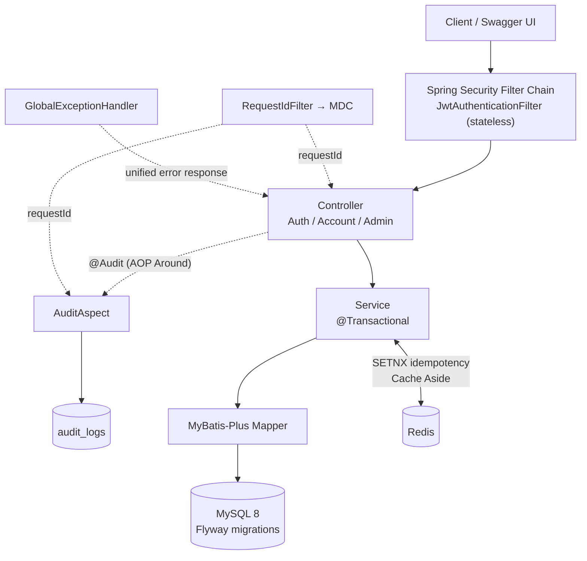
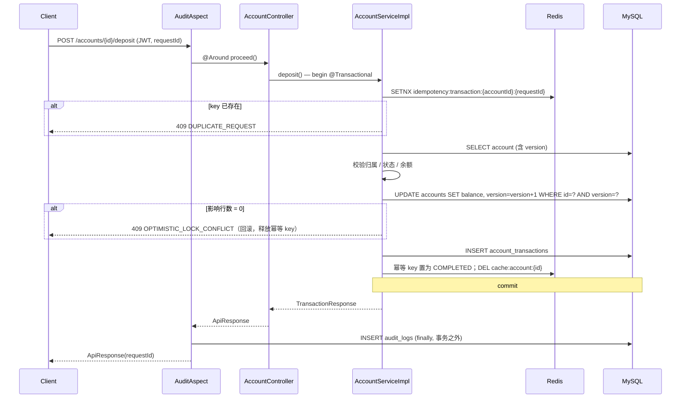
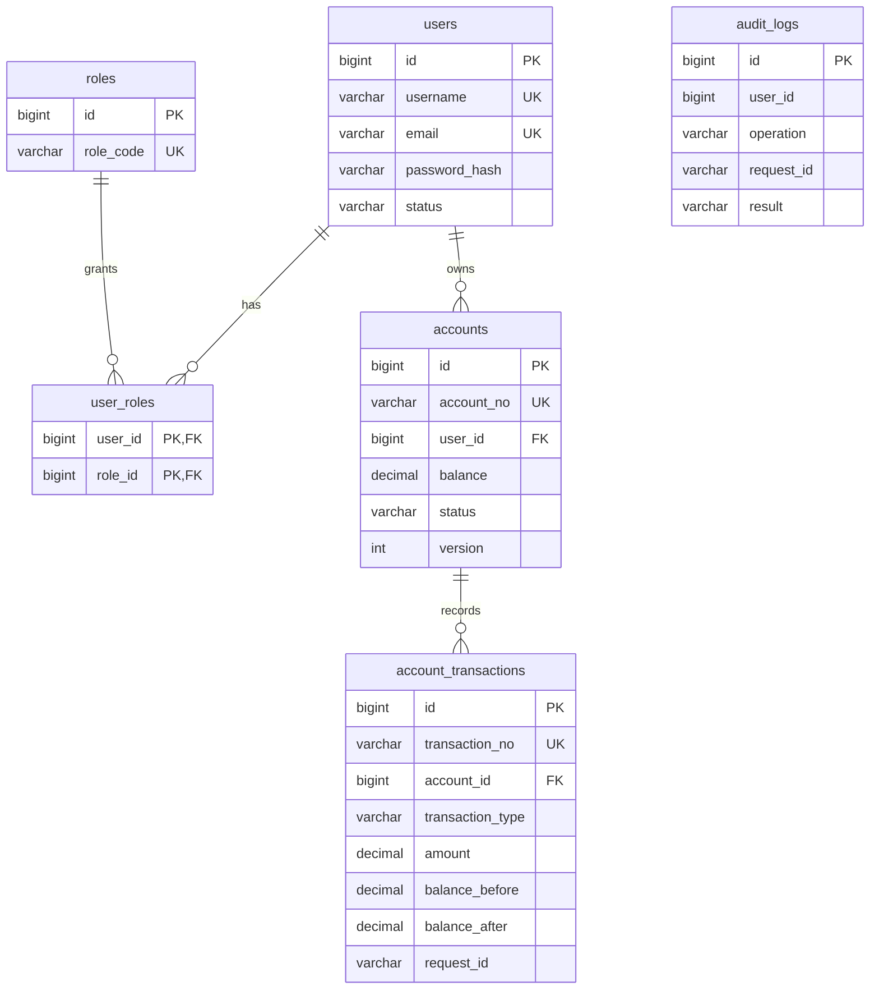

# CoreLedger｜企业账户与交易管理系统

> Enterprise Account & Transaction Ledger Service — a Java 17 / Spring Boot 3 backend focused on **transaction consistency, concurrency control, idempotency, caching, security and auditability**.

    

## 1. Project Overview｜项目概述

CoreLedger 是面向小型商贸企业内部资金管理场景的 Java 后端服务，围绕 **用户 → 角色 → 账户 → 交易流水 → 审计日志** 构建核心业务闭环：

- 员工注册/登录，通过 JWT 访问接口；普通用户只能操作自己的账户，管理员可查看全部用户、账户和审计日志。
- 账户支持入账（deposit）和出账（withdraw），每笔变动都生成带有 `balance_before / balance_after` 的交易流水。
- 重点解决资金类系统的典型问题：**余额与流水原子性、并发更新覆盖、重复提交、缓存一致性、权限边界、操作可追溯**。

项目范围：聚焦账户与流水闭环，不包含支付网关、MQ、微服务、分布式事务和 ERP 模块。运行验证均在本地 Docker Compose 环境完成，**未部署到生产环境**，文中不包含任何性能（TPS/QPS）或用户规模数据。

## 2. Highlights｜项目亮点

| # | 亮点 | 一句话说明 |
| --- | --- | --- |
| 1 | 分层架构 | Controller → Service → MyBatis-Plus Mapper；DTO 使用 Java `record` + Jakarta Validation；统一 `ApiResponse` 与 `ErrorCode` |
| 2 | 数据建模 | MySQL 8 六张核心表，金额使用 `DECIMAL(19,2)`，Flyway 版本化迁移 |
| 3 | 安全 | Spring Security 6 无状态 JWT + BCrypt + URL 级 RBAC（`/api/v1/admin/**` 仅 `ROLE_ADMIN`）+ 账户归属校验 |
| 4 | 事务一致性 | `@Transactional` 包裹「更新余额 + 写入流水」，任一步失败整体回滚 |
| 5 | 乐观锁 | `accounts.version` + MyBatis-Plus `@Version`，CAS 式更新，冲突返回 `OPTIMISTIC_LOCK_CONFLICT` |
| 6 | 双层幂等 | Redis `SETNX` 快速拦截 + `UNIQUE(account_id, request_id)` 数据库兜底 |
| 7 | 缓存 | 账户详情 Cache Aside，`__NULL__` 空值标记防缓存穿透，写后删缓存 |
| 8 | 可观测 | `@Audit` + Spring AOP 记录审计日志；`requestId` 写入响应头、MDC 日志与审计表 |
| 9 | 工程化 | JUnit 5 + Mockito 单元测试；Dockerfile 多阶段构建；Docker Compose 一键启动 MySQL + Redis + App |

## 3. Architecture｜架构设计



一次出入账请求的调用链：



## 4. Core Design｜核心技术设计

> 格式：**业务场景 → 技术机制 → 设计价值**。代码片段摘自仓库，省略部分用 `...` 标注。

### 4.1 账户余额与交易流水一致性

- **场景**：一笔入账/出账既要改余额，也要留流水；只成功一半会导致账实不符。
- **机制**：`deposit` / `withdraw` 在 Service 的 public 方法上声明 `@Transactional`，内部 `changeBalance` 依次完成「读账户 → 校验归属/状态/余额 → 乐观锁更新余额 → 写流水」。余额不足、账户停用、乐观锁冲突都会抛出 `BusinessException`，触发回滚。
- **价值**：余额与流水同成功、同失败；流水记录 `balance_before / balance_after`，可用于事后对账。

```java
@Override
@Transactional
public TransactionResponse withdraw(Long accountId, TransactionRequest request, CurrentUser user) {
    return changeBalance(accountId, request, user, TransactionType.WITHDRAW);
}
// changeBalance(...)
BigDecimal after = type == TransactionType.DEPOSIT ? before.add(amount) : before.subtract(amount);
if (type == TransactionType.WITHDRAW && after.compareTo(BigDecimal.ZERO) < 0) {
    throw new BusinessException(ErrorCode.INSUFFICIENT_BALANCE);
}
```

事务边界：`@Transactional` 在 Service 层；`@Audit` 切面在 Controller 层、位于事务外侧，因此业务回滚后审计记录仍会以 `FAIL` 写入（见 4.6）。

### 4.2 并发更新与乐观锁

- **场景**：两个请求同时读到余额 100，各自 +10，后提交者会覆盖先提交者，造成 Lost Update。
- **机制**：`Account.version` 标注 `@Version`，`MybatisPlusConfig` 注册 `OptimisticLockerInnerInterceptor`。`updateById` 会带上 `version = version + 1 ... WHERE id = ? AND version = ?`；影响行数为 0 说明该行已被他人修改。
- **价值**：冲突被检测而不是被静默覆盖；失败请求整体回滚并返回 `409 OPTIMISTIC_LOCK_CONFLICT`，由客户端决定是否重试（服务端不自动重试）。

```java
int updated = accountMapper.updateById(account);
if (updated != 1) {
    throw new BusinessException(ErrorCode.OPTIMISTIC_LOCK_CONFLICT);
}
```

### 4.3 请求幂等与重复交易防护

- **场景**：网络超时重试、用户连点按钮，同一笔扣款被提交多次。
- **机制**：请求必须携带 `requestId`（`@NotBlank`，≤64 字符）。
  1. **Redis 层**：`SETNX idempotency:transaction:{accountId}:{requestId}`（值 `PROCESSING`，TTL 默认 3600s）。已存在即返回 `409 DUPLICATE_REQUEST`；业务成功后改写为 `COMPLETED`；业务失败在 `finally` 中删除 key，避免失败请求永久占用 `requestId`。
  2. **数据库层**：`account_transactions` 上 `UNIQUE KEY (account_id, request_id)`。Redis key 过期或 Redis 层被绕过时，重复流水无法落库，事务回滚，余额不会被重复修改。
- **价值**：Redis 负责低成本的快速拦截，数据库约束负责最终正确性。
- **注意区分两个 requestId**：请求体里的 `requestId` 是**业务幂等键**，由客户端为每笔交易生成，用于防重复扣款；请求头里的 `X-Request-Id` 是**链路追踪 ID**，缺省由服务端生成，用于日志、响应和审计关联（见 4.6）。两者互相独立，不能互相替代。

```java
Boolean acquired = redisTemplate.opsForValue()
        .setIfAbsent(idempotencyKey, "PROCESSING", Duration.ofSeconds(properties.idempotency().ttlSeconds()));
if (!Boolean.TRUE.equals(acquired)) {
    throw new BusinessException(ErrorCode.DUPLICATE_REQUEST);
}
```

### 4.4 缓存与数据库一致性

- **场景**：账户详情读多写少，希望减轻 MySQL 压力，同时不能长期返回旧余额。
- **机制**：`GET /accounts/{id}` 走 Cache Aside：读 `cache:account:{id}` → 未命中查库并回写（TTL 默认 300s）→ 余额变更/创建账户后 `DEL` 缓存。账户不存在时写入 `__NULL__`（TTL 默认 60s），避免对不存在 ID 的反复查询穿透到 MySQL。账户列表与交易流水不走缓存，直接读库。
- **价值**：读路径加速；采用「删除缓存而非更新缓存」降低并发写入造成脏缓存的概率，TTL 作为最终兜底。
- **取舍**：缓存删除发生在事务提交之前，极端并发下可能存在短暂读到旧值的窗口，最长受 TTL 限制。当前规模下不引入 Bloom Filter 或延迟双删。

### 4.5 JWT / RBAC 安全控制

- **场景**：区分普通员工与管理员，且服务端保持无状态。
- **机制**：
  - 登录：`AuthenticationManager` + `DaoAuthenticationProvider` + `BCryptPasswordEncoder` 校验，成功后签发 HS256 JWT（claims：`userId`、`roles`，subject 为用户名，默认有效期 7200s）。
  - 请求：`JwtAuthenticationFilter` 解析 Bearer Token，把 `CurrentUser` 与来自 token 的角色写入 `SecurityContext`。
  - 授权：`SecurityConfig` 中 `/api/v1/admin/**` 要求 `hasRole("ADMIN")`；未认证/无权限由 `RestAuthenticationEntryPoint` / `RestAccessDeniedHandler` 返回统一 JSON（401 / 403）。
  - 数据级权限：Service 的 `assertAccountReadable` 校验账户归属，非管理员访问他人账户返回 `ACCOUNT_NOT_FOUND`，不暴露资源是否存在。
  - JWT 密钥来自环境变量 `JWT_SECRET`，不硬编码。
- **价值**：URL 级角色控制 + 数据级归属控制两层防护。

### 4.6 审计日志与链路追踪

- **场景**：资金操作需要回答「谁、何时、做了什么、结果如何」，并能把一次请求的日志、响应和审计记录串起来。
- **机制**：
  - `@Audit(operation, resource)` 标注在 Controller 方法上（注册、登录、创建账户、入账、出账及三个管理端查询）。`AuditAspect`（`@Around`）在 `finally` 中写入 `audit_logs`：用户、操作、HTTP method/URI、IP、`requestId`、`SUCCESS/FAIL`。审计写入失败只记 warn 日志，不影响主业务。
  - `RequestIdFilter` 读取 `X-Request-Id`，缺省生成 UUID，放入 MDC 与响应头；`ApiResponse` 带 `requestId`；日志格式含 `[%X{requestId}]`。
- **区别于幂等键**：这里的 `requestId` 来自请求头 `X-Request-Id`（用于追踪），与交易请求体中的 `requestId`（用于幂等，见 4.3）是两个概念。
- **价值**：AOP 把审计从业务代码中解耦；MDC 解决「哪些日志行属于同一个请求」，审计表解决「谁做了什么」，两者通过 `requestId` 关联。

## 5. Database Design｜数据库设计

Schema 由 Flyway 管理：`V1__init_schema.sql` 建表，`V2__init_roles.sql` 初始化 `ROLE_USER` / `ROLE_ADMIN`，应用启动时自动迁移。



| 表 | 关键约束 / 索引 | 作用 |
| --- | --- | --- |
| `users` | `UK(username)`、`UK(email)` | 防重复注册 |
| `roles` / `user_roles` | `UK(role_code)`；`PK(user_id, role_id)` + 两个外键 | RBAC 多对多 |
| `accounts` | `UK(account_no)`、`idx(user_id)`、`idx(created_at)`、`version INT` | 账户唯一标识、按用户/时间分页、乐观锁 |
| `account_transactions` | `UK(transaction_no)`、**`UK(account_id, request_id)`**、`idx(account_id)`、`idx(created_at)` | 流水唯一、**幂等兜底**、按账户/时间查询 |
| `audit_logs` | `idx(user_id)`、`idx(request_id)`、`idx(created_at)` | 按用户、请求链路、时间检索 |

设计要点：金额统一 `DECIMAL(19,2)` + Java `BigDecimal`，避免浮点误差；`audit_logs` 不设外键，审计记录不依赖业务表的生命周期。

## 6. API Overview｜接口概览

统一前缀 `/api/v1`，统一响应 `ApiResponse{code, message, data, timestamp, requestId}`；分页参数 `page`（≥1）、`size`（1~100）。Swagger UI：`/swagger-ui.html`，OpenAPI：`/v3/api-docs`。

| 模块 | 方法与路径 | 权限 | 说明 |
| --- | --- | --- | --- |
| Auth | `POST /auth/register` | 公开 | 注册，默认绑定 `ROLE_USER` |
| Auth | `POST /auth/login` | 公开 | 登录，返回 Bearer JWT |
| Auth | `GET /users/me` | 登录用户 | 当前用户信息 |
| Account | `POST /accounts` | 登录用户 | 创建账户（初始余额 0） |
| Account | `GET /accounts` | 登录用户 | 分页列表；普通用户仅自己的，管理员为全部 |
| Account | `GET /accounts/{id}` | 登录用户 | 账户详情（Cache Aside） |
| Transaction | `POST /accounts/{id}/deposit` | 登录用户 | 入账，需 `amount`、`requestId` |
| Transaction | `POST /accounts/{id}/withdraw` | 登录用户 | 出账，需 `amount`、`requestId` |
| Transaction | `GET /accounts/{id}/transactions` | 登录用户 | 流水分页，可按 `transactionType`、`startTime`、`endTime` 过滤 |
| Admin | `GET /admin/users` | `ROLE_ADMIN` | 用户列表 |
| Admin | `GET /admin/accounts` | `ROLE_ADMIN` | 全部账户 |
| Admin | `GET /admin/audit-logs` | `ROLE_ADMIN` | 审计日志 |

业务错误码（节选）：`2003 INSUFFICIENT_BALANCE`(400)、`3001 DUPLICATE_REQUEST`(409)、`3002 OPTIMISTIC_LOCK_CONFLICT`(409)、`4001 UNAUTHORIZED`(401)、`4003 FORBIDDEN`(403)。

入账请求示例（字段来自 `TransactionRequest`）：

```bash
curl -X POST http://localhost:8080/api/v1/accounts/1/deposit \
  -H "Authorization: Bearer $TOKEN" -H 'Content-Type: application/json' \
  -d '{"amount":1000.00,"requestId":"deposit-demo-001","remark":"initial fund entry"}'
# 使用相同 requestId 再次提交 → HTTP 409，code=3001
```

## 7. Tech Stack｜技术栈

| 类别 | 技术 | 用途 |
| --- | --- | --- |
| Language / Framework | Java 17、Spring Boot 3.3.5、Spring MVC | 后端主体 |
| Security | Spring Security 6、jjwt 0.12.6、BCrypt | 认证、授权、密码哈希 |
| Persistence | MyBatis-Plus 3.5.7、MySQL 8.0、Flyway | ORM、分页、乐观锁插件、Schema 迁移 |
| Cache / Idempotency | Redis 7（`StringRedisTemplate`） | SETNX 幂等、账户缓存 |
| AOP | Spring AOP / AspectJ | `@Audit` 审计切面 |
| Validation | Jakarta Validation | 参数校验 |
| API Docs | springdoc-openapi 2.6.0 | Swagger UI |
| Testing | JUnit 5、Mockito、Spring Boot Test | 单元测试 |
| Build / Run | Maven、Docker（多阶段构建）、Docker Compose | 构建与本地容器化运行 |

## 8. Quick Start｜运行与部署

环境要求：Java 17、Maven 3.9+、Docker / Docker Compose。以下为**本地**运行方式，不代表生产部署方案。

**方式一：Docker Compose 全栈（MySQL + Redis + App）**

```bash
cp .env.example .env          # 按需修改占位值：MYSQL_*、JWT_SECRET（≥32 字符）
docker compose up -d --build
# 应用：http://localhost:8080   Swagger：http://localhost:8080/swagger-ui.html
docker compose down           # 停止
```

**方式二：容器只跑依赖，应用在本机运行**

```bash
docker compose up -d mysql redis
export JWT_SECRET="$(openssl rand -hex 32)"
mvn spring-boot:run
```

说明：

- `.env.example` 中的 `change_me` 仅为占位值，请替换；`.env` 不应提交到仓库。
- Flyway 在启动时自动执行迁移并写入两个内置角色。
- 可配置的环境变量：`DB_URL`、`DB_USERNAME`、`DB_PASSWORD`、`REDIS_HOST`、`REDIS_PORT`、`REDIS_PASSWORD`、`JWT_SECRET`、`JWT_EXPIRATION_SECONDS`、`IDEMPOTENCY_TTL_SECONDS`、`ACCOUNT_CACHE_TTL_SECONDS`、`NULL_CACHE_TTL_SECONDS`。
- 注册接口只授予 `ROLE_USER`，项目没有“授予管理员”的接口。调试管理端接口时，先在数据库中绑定角色，再**重新登录**获取包含 `ROLE_ADMIN` 的新 JWT：

```sql
INSERT INTO user_roles (user_id, role_id)
SELECT u.id, r.id FROM users u, roles r
WHERE u.username = '<your-username>' AND r.role_code = 'ROLE_ADMIN';
```

## 9. Testing｜测试与验证

### 9.1 自动化单元测试（源码核对：共 8 个 `@Test`）

| 测试类 | 覆盖用例 |
| --- | --- |
| `AccountServiceImplTest`（6） | 创建账户；入账成功；出账成功；余额不足时抛 `INSUFFICIENT_BALANCE` 并删除幂等 key；重复 `requestId` 抛 `DUPLICATE_REQUEST`；`updateById` 返回 0 时抛 `OPTIMISTIC_LOCK_CONFLICT` 并释放幂等 key |
| `AuthServiceImplTest`（2） | 注册成功；用户名重复抛业务异常 |

```bash
mvn clean test
```

测试用 Mockito 隔离 Mapper 与 Redis，验证 Service 层业务分支。仓库**没有**带真实 MySQL/Redis 的自动化集成测试，也没有覆盖率报告，因此不给出覆盖率数字。

### 9.2 本地运行验证（手工，Docker Compose 环境）

根据此前的本地手工验证记录，项目已完成覆盖基础设施、认证授权、交易一致性、幂等及审计等功能的 19 项检查（下表）。这些检查由人工在本地 Docker Compose 环境执行，仓库中没有对应的验证脚本和日志，**不会在每次构建时自动运行**；它们验证的是功能正确性，不是性能基准。

| 分组 | 验证项 |
| --- | --- |
| 基础设施 | Docker daemon、MySQL 8、Redis、Flyway 迁移、Spring Boot 启动、Docker Compose 全栈（容器内应用连接容器内 MySQL/Redis） |
| 认证与权限 | 注册/登录、JWT、RBAC（普通用户访问管理端 403，管理员 token 可访问） |
| 业务功能 | 账户管理、入账/出账、交易流水查询、事务回滚（余额不足时余额不变且无成功流水） |
| 一致性机制 | Redis 缓存、幂等（相同 `requestId` 不重复改余额/不重复生成流水）、乐观锁（同一账户并发修改时冲突被检测并拒绝） |
| 可观测与文档 | 审计日志、RequestId + MDC、Swagger/OpenAPI |

## 10. Interview Highlights｜面试要点

**Q1. 为什么用乐观锁而不是悲观锁（`SELECT ... FOR UPDATE`）？**
账户余额更新是短事务，且同一账户在同一时刻被并发修改的概率较低，乐观锁不需要长时间持有行锁，吞吐和死锁风险都更友好。本项目用 `version` 做 CAS：`UPDATE ... WHERE id=? AND version=?`，影响行数为 0 即冲突，返回 409 让调用方重试。如果某个账户是高频热点（冲突率高），重试成本上升，才考虑悲观锁或单账户串行化。

**Q2. `@Transactional` 的事务边界在哪里？**
在 `AccountServiceImpl.deposit/withdraw` 这两个 public 方法上，通过 Spring 代理生效；`changeBalance` 是同类内私有方法，由这两个入口调用，处于同一个事务。事务内包含「更新余额 + 插入流水」两条 SQL；Redis 操作不在事务管理范围内，所以代码里用 `try/finally` 手动补偿幂等 key。审计切面在 Controller 层，位于事务外侧。运行时异常默认回滚，本项目的 `BusinessException` 属于运行时异常。

**Q3. 如何防止重复扣款？**
三层：① 参数校验要求每次请求带 `requestId`；② Redis `SETNX` 以 `accountId + requestId` 为 key 拦截重复提交；③ 数据库 `UNIQUE(account_id, request_id)` 保证同一 `requestId` 不可能产生两条流水，重复写入会使整个事务回滚，余额不会被改两次。

**Q4. Redis SETNX 与数据库唯一约束为什么要组合？**
Redis 快、能在进入数据库前挡住绝大多数重复请求，但 key 有 TTL、Redis 也可能故障或丢数据，不能当作唯一依据；数据库唯一约束是持久、强一致的最终防线，但只靠它每个重复请求都要走一遍事务并以异常收场，代价更高。组合后：Redis 管效率，数据库管正确性。边界说明：Redis 层的重复返回业务码 3001；Redis 失效后命中数据库唯一约束时，事务会回滚保证余额正确，当前由通用异常处理返回错误响应（可进一步把 `DuplicateKeyException` 映射为 `DUPLICATE_REQUEST`）。

**Q5. 业务失败时为什么要删除幂等 key？**
`PROCESSING` 的 key 在业务失败（余额不足、乐观锁冲突等）后如果保留，客户端用同一 `requestId` 重试会被误判为重复。所以 `finally` 中在 `completed == false` 时删除 key；成功则保留 `COMPLETED` 直到 TTL 过期。

**Q6. Cache Aside 有哪些一致性取舍？**
读：先缓存后库并回写；写：先改库再删缓存（删除而不是更新，避免并发写入互相覆盖出脏缓存）。取舍：本项目的删除发生在事务提交之前，极端并发下读请求可能在提交前把旧值回填缓存，最长受 `ACCOUNT_CACHE_TTL_SECONDS`（默认 300s）限制；更严格的做法是事务提交后再删（`TransactionSynchronization.afterCommit`）或延迟双删。空值缓存 `__NULL__` 用 60s 短 TTL 防穿透，账户创建时会主动删除对应缓存 key。余额写入路径始终读库而不读缓存，所以缓存不会影响余额计算的正确性。

**Q7. JWT 和 RBAC 如何配合？**
登录时把用户角色写入 JWT 的 `roles` claim；每次请求 `JwtAuthenticationFilter` 验签后把角色转成 `GrantedAuthority`，`SecurityConfig` 对 `/api/v1/admin/**` 要求 `hasRole("ADMIN")`。同时 Service 层对账户做归属校验，防止越权访问他人账户。取舍：角色保存在 token 中，服务端无需查库，但角色变更需要重新登录才生效，token 有效期默认 2 小时。

**Q8. AOP 与 MDC 分别解决什么问题？**
AOP（`@Audit` + `AuditAspect`）解决「业务操作留痕」：把审计从业务代码里横向抽出来，统一记录用户、操作、结果和请求信息，且审计失败不影响主业务。MDC 解决「日志串联」：`RequestIdFilter` 把 `requestId` 放进线程上下文，所有日志行自动带上它，并同时写入响应头、响应体和审计表，凭一个 ID 就能还原一次请求的完整路径。

**Q9. 如何验证并发安全与幂等性？**
单元测试层面：Mockito 模拟 `setIfAbsent` 返回 false 验证重复请求，模拟 `updateById` 返回 0 验证乐观锁冲突与幂等 key 释放。运行层面：在 Docker Compose 环境对同一账户发起多个并发余额修改请求，确认冲突被拒绝而非静默覆盖；用相同 `requestId` 重复提交，确认余额和流水只变化一次。后续如要自动化，可用 Testcontainers + 多线程 `CountDownLatch` 写集成测试，断言「成功次数 × 金额 = 最终余额变化」且流水条数一致。

**Q10. 为什么余额不足的判断不能只靠 `@Transactional`？**
`@Transactional` 只保证多条 SQL 的原子性，不保证并发下“读—判断—写”的互斥。如果没有乐观锁，两个出账请求可能都读到余额 100、都通过「余额 ≥ 80」的判断并各自提交，造成超扣。本项目用 `version` 条件更新把“读到的状态”绑定到“写入的条件”，使其中一个请求更新失败。MySQL 默认 REPEATABLE READ 下，普通 `SELECT` 是快照读，真正起互斥作用的是 `UPDATE ... WHERE version = ?` 的当前读。

**Q11. 为什么金额用 `DECIMAL` / `BigDecimal`？**
`double` 无法精确表示大多数十进制小数，累计运算会产生误差。数据库使用 `DECIMAL(19,2)`，Java 使用 `BigDecimal`，并在入账前统一 `setScale(2)`；请求 DTO 使用 `@Positive` 拒绝非正数金额。

## 11. Project Structure｜项目结构

```text
Core-Ledger
├── docker-compose.yml / Dockerfile / .env.example   # 本地容器化运行
├── pom.xml
├── ARCHITECTURE.md                                  # 补充架构说明
└── src
    ├── main
    │   ├── java/com/coreledger
    │   │   ├── controller/   Auth / Account / Admin REST 接口
    │   │   ├── service/impl/ 业务逻辑：AccountServiceImpl（事务、幂等、缓存）
    │   │   ├── mapper/       MyBatis-Plus Mapper
    │   │   ├── entity/       实体（Account 含 @Version）
    │   │   ├── dto/          request / response record
    │   │   ├── security/     JwtTokenProvider、JwtAuthenticationFilter、CustomUserDetailsService
    │   │   ├── config/       SecurityConfig、MybatisPlusConfig、CoreLedgerProperties、OpenApiConfig
    │   │   ├── aspect/       AuditAspect
    │   │   ├── annotation/   @Audit
    │   │   ├── common/       ApiResponse、GlobalExceptionHandler、RequestIdFilter、工具类
    │   │   └── enums/        ErrorCode、TransactionType、AccountStatus、UserStatus
    │   └── resources
    │       ├── application.yml
    │       └── db/migration/ V1__init_schema.sql、V2__init_roles.sql
    └── test/java/com/coreledger/service/   AccountServiceImplTest、AuthServiceImplTest
```
